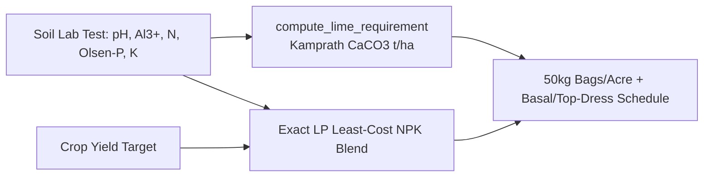

# soilblend-opt

[](https://github.com/codesphere-u/soilblend-opt/actions/workflows/ci.yml)
[](LICENSE)
[](pyproject.toml)
[](pyproject.toml)

**Zero-dependency soil fertility & fertilizer blend optimizer: Kamprath acidic soil CaCO3 lime neutralization, soil-test crop N-P-K gap analysis, pure-Python LP least-cost NPK blending, and split-application schedules.**

- **Mission Domain:** AgriTech & Precision Soil Fertility
- **Stack:** Pure Python 3.11+ (zero runtime third-party dependencies, `mypy --strict`, `ruff`, `pytest`)
- **Maintainer:** Codesphere Innovations (U) Limited (`codesphere-u`)

---

## Problem Solved

Smallholder farmers on acidic East African Oxisols/Ultisols (pH < 5.3) waste expensive DAP and NPK fertilizers to aluminum phosphorus-fixation and non-optimal blanket bag recommendations.

## Key Features

- Kamprath exchangeable-acidity (`Al3+`) and texture-buffer agricultural lime (`CaCO3 t/ha` & 50 kg bags/acre) calculator with phosphorus-fixation warnings (`compute_lime_requirement`).
- Soil-test crop nutrient balance (`optimize_fertilizer_blend`) across maize, beans, Irish potato, rice, Arabica coffee, and highland banana.
- Exact vertex-enumeration linear-programming least-cost blend solver across DAP, TSP, Urea, CAN, MOP, and NPK 17-17-17 with basal vs. top-dress split schedules.

## Architecture Overview



See [docs/architecture.md](docs/architecture.md) for module-level design details.

## Installation

```bash
git clone https://github.com/codesphere-u/soilblend-opt.git
cd soilblend-opt
uv sync --extra dev
```

Or install in editable mode with standard `pip`:

```bash
pip install -e ".[dev]"
```

## Quick Start (CLI)

```bash
soilblend-opt --crop maize --yield-t-ha 6.0 --ph 5.1 --olsen-p 6.0
```

## Quick Start (Python API)

```python
from soilblend_opt import SoilTest, optimize_fertilizer_blend

rec = optimize_fertilizer_blend(SoilTest(soil_ph=5.1, olsen_p_mg_kg=6.0), 'maize', target_yield_t_ha=5.0)
assert rec.lime.lime_required_t_ha > 0 and rec.supplied_n_kg_ha >= rec.required_n_kg_ha - 0.5
```

## Testing & Quality Gates

```bash
uv run ruff check src tests
uv run mypy src
uv run pytest -v
```

## Security, Contributing & Roadmap

- **Security:** See [SECURITY.md](SECURITY.md) for responsible disclosure procedures.
- **Contributing:** See [CONTRIBUTING.md](CONTRIBUTING.md) and [CODE_OF_CONDUCT.md](CODE_OF_CONDUCT.md).
- **Changelog & Roadmap:** See [CHANGELOG.md](CHANGELOG.md) and [ROADMAP.md](ROADMAP.md).

## License

MIT License — see [LICENSE](LICENSE).

## Support & Contact

Open an issue on [GitHub Issues](https://github.com/codesphere-u/soilblend-opt/issues) or contact `codesphereinnovationz@gmail.com`.
